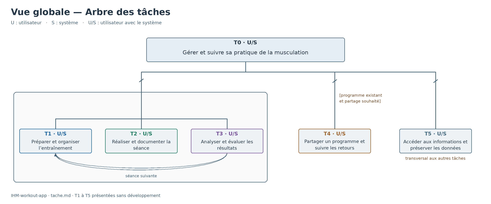
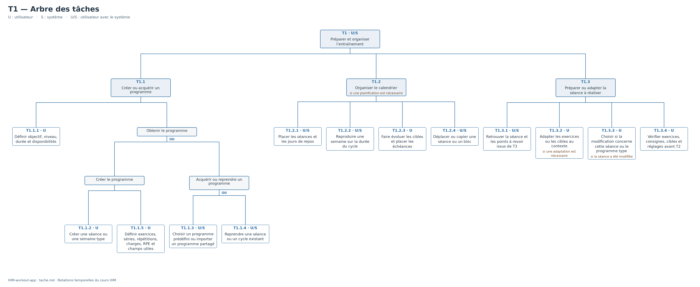
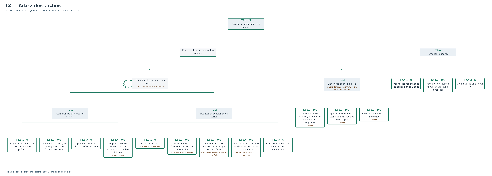
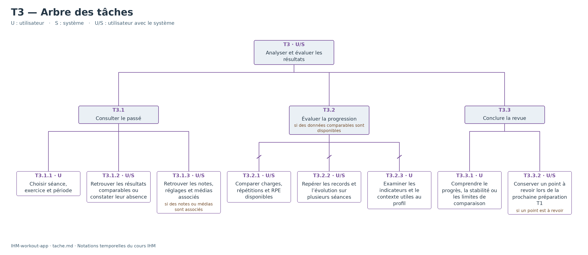
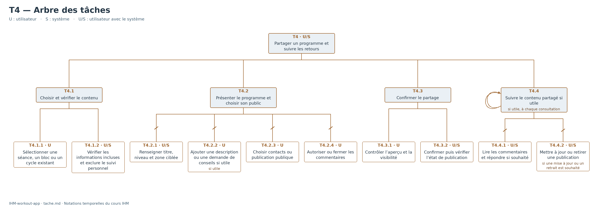
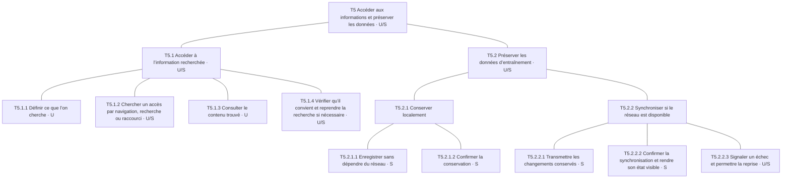

# Arbres des tâches — Musculation

Les schémas ci-dessous présentent la vue globale et le détail de T1 à T4. T5 reste dans la vue globale ; son schéma existant est conservé.

## Vue globale

## T1 — Préparer et organiser l’entraînement

## T2 — Réaliser et documenter la séance

## T3 — Analyser et évaluer les résultats

## T4 — Partager un programme et suivre les retours

## Lecture des schémas

- Embranchement sans barre : séquence de gauche à droite.
- Embranchement barré : suite sans ordre imposé.
- « OU » : choix entre les branches.
- Double arc relié aux tâches : répétition ; retour de T3 vers T1 pour la séance suivante.
- Les conditions précisent quand une tâche est exécutée.

Les libellés sont issus de [l’arbre consolidé tache.md](https://github.com/fergouchyahya/IHM-workout-app/blob/main/docs/04-analyse-taches/tache.md). Des regroupements permettent de représenter les alternatives et les répétitions.

## Note d’audit — 4 novembre 2026

Les PNG ont été contrôlés visuellement lors de cette revue. La vue globale reprend bien T0–T5 et indique T5 comme transversal. Les détails T1–T4 suivent la hiérarchie et les répétitions principales ; T1 rend T1.1.1 avant le choix de programme, cohérent avec la clarification du 4 novembre. T2.3.3 « photo ou vidéo » désigne les médias personnels associés à une séance (pris en charge localement par enrichissement.js), et non une démonstration pédagogique fournie par l’application. Il n’y a pas d’écart de tâche sur ce point. T5 ne montre pas le nœud T5.2.2.3 « Signaler un échec et permettre la reprise », pourtant présent dans `tache.md` ; la vue Mermaid corrigée ci-dessous rétablit ce nœud sans modifier la hiérarchie textuelle. Le PNG ancien est conservé comme preuve historique. Les images restent statiques et ne donnent ni date de génération ni source éditable. Toute modification de hiérarchie doit d’abord être faite dans `tache.md`, puis les images doivent être régénérées et datées.

## T5 — Vue corrigée éditable (4 novembre 2026)

Source : [tache.md](tache.md), identifiants inchangés. Les traits décrivent la décomposition, pas une séquence globale. T5.1 et T5.2 sont transverses, sans ordre imposé. Dans T5.1, une recherche insatisfaisante revient à T5.1.2 ; dans T5.2, la conservation locale précède l’envoi éventuel. T5.2.2 reste hors réalisation réseau du frontend.

